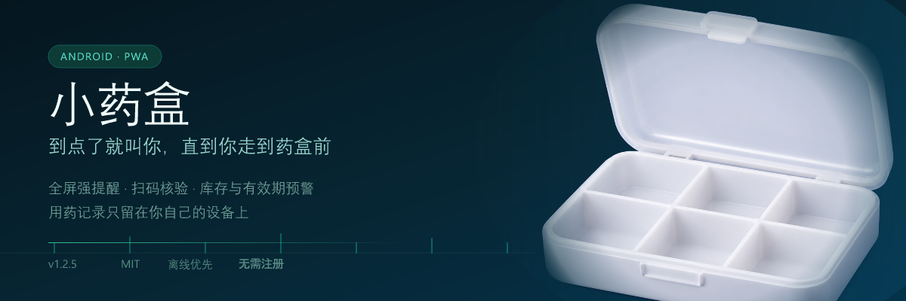

# 小药盒 (xiaoyaohe)

**贴心的家庭用药提醒与药箱管理助手**

小药盒是一款专为家庭日常用药与长辈照护设计的离线优先应用。我开发这款工具的初衷，是为了解决日常生活中经常遇到的漏服、重复服药、药品过期以及断药忘记补充等问题。

应用同时提供 Android 原生客户端与 Web 网页端（PWA），所有用药记录与库存信息均保存在您的本地设备中，无需注册账号，没有外部云端依赖，也不包含任何商业广告。

---

## 核心守护机制

为了确保提醒能够真正促成服药动作，小药盒在交互设计上提供了三重针对性的守护机制：

### 1. 全屏防误触强提醒

常规的通知栏推送容易被其他应用消息淹没，或者在无意划动中被清除。

- **沉浸全屏警报**：提醒触发时，应用直接唤起全屏提醒界面，配合持续铃声与震动提示；
- **防误触离开守护**：对于设置为强提醒的药物，如果误按了返回键或切换应用，系统会自动守护前台焦点，防止在未确认服药的情况下意外退出；
- **上滑延后（贪睡）**：若当前正在处理紧急事项无法立即服药，向上滑动界面可快捷选择延后 10 分钟提醒，系统会立即暂停当前警报，到期后再次提醒；
- **5 秒应急暗门**：在极端紧急或特殊场景下，长按提醒界面的药盒二维码图标 5 秒，可唤起应急选项跳过本次提醒，避免界面死锁。

### 2. 药盒条形码扫描核验

很多漏服并不是忘记了提醒，而是在手机上顺手点击了「已服」，之后因为手头琐事打岔，实际上并未走到药盒前取药。

- **实物核验确认**：我们可以为药品关联药盒或药瓶上的条形码。开启该选项后，提醒响起时必须使用手机摄像头扫描真实的药盒条形码，系统核验一致后才会确认服药并解除警报；
- **降噪稳焦**：进入摄像头扫码界面时，震动马达会自动静音，避免机身微震干扰摄像头对焦与条码识别。

### 3. 智能库存扣减与有效期预警

- **自动扣减库存**：每次确认服药后，系统会按照单次用量自动扣减对应药品的剩余库存；
- **余量不足提醒**：当药品剩余剂量低于设定的安全阈值时，首页与列表会标明预警，提醒我们提前备药；
- **多批次有效期追踪**：支持同一药品记录多个购药批次与到期日，优先消耗临近到期批次，药品过期前自动发出预警。

---

## 常用功能

除了核心的服药守护，小药盒还涵盖了日常药箱管理的完整流程：

- **今日服药清单**：按早、中、晚、睡前等时间段清晰聚合展示今日待服与已服药品，状态一目了然；
- **拍照与条形码快速录入**：支持扫描药盒条形码或拍摄药品包装，快速录入药品名称、规格、批号与有效期；
- **用药历史追溯**：完整记录每次服药的时间、剂量与确认方式，方便就医或复盘时核对用药情况；
- **局域网点对点同步**：在同一局域网（Wi-Fi）内，支持两台手机之间直接通过本地加密连接同步药品数据与更新安装包，无需经过任何第三方公网服务器；
- **大字号与高对比度**：严格遵循无障碍与适老化标准，提供充足的点击热区与清晰的文字对比度，方便长辈独立查看。

---

## 获取与使用

### Android 手机端（推荐）

Android 客户端支持完整的原生全屏提醒、后台保活、震动控制与扫码核验。

1. 进入 [Releases 页面](https://github.com/Misakii1k/xiaoyaohe/releases) 下载最新版的发布包（例如 `xiaoyaohe-1.0.0-android-release.apk`）；
2. 在手机上打开并完成安装；
3. 首次打开时，根据系统提示授予「通知权限」与「忽略电池优化」权限，以保证系统能在熄屏时准时唤醒提醒。

### Web 网页端 / PWA

如果您使用的是电脑浏览器或希望直接在线体验：

1. 使用现代浏览器访问 [小药盒 Web 端](https://misakii1k.github.io/xiaoyaohe/)；
2. 移动端可在浏览器菜单中选择「添加到主屏幕」，即可作为独立 PWA 应用离线使用。

---

## 数据与隐私安全

- **数据保留在本地**：所有药品清单、用药记录与个人偏好均保存在设备本地的 IndexedDB 数据库中；
- **无云端账户**：我们不需要注册账户或提供手机号码，应用也不收集个人健康隐私；
- **局域网直连同步**：如果需要在多台设备之间传输数据，两台设备必须连接同一路由器，在应用内扫描配对码建立直接加密传输通道，整个过程不经过公网服务器中转；
- **数据备份与恢复**：设置页面提供一键导出 JSON 备份功能，方便随时将数据迁移到新手机。

---

## 系统要求

| 运行平台 | 最低版本要求 | 建议说明 |
|---|---|---|
| Android | Android 8.0 (API 26) 及以上 | 建议开启自启动与电池白名单，确保息屏强提醒准时响铃 |
| Web / PWA | Chrome 90+ / Safari 15+ / Edge 90+ | 需支持 IndexedDB 与现代 Web API |

---

## 参与与许可

本项目代码遵循 [MIT 许可证](LICENSE) 开源。

如在使用过程中遇到问题或有优化建议，欢迎在 GitHub 提交 [Issue](https://github.com/Misakii1k/xiaoyaohe/issues)。
