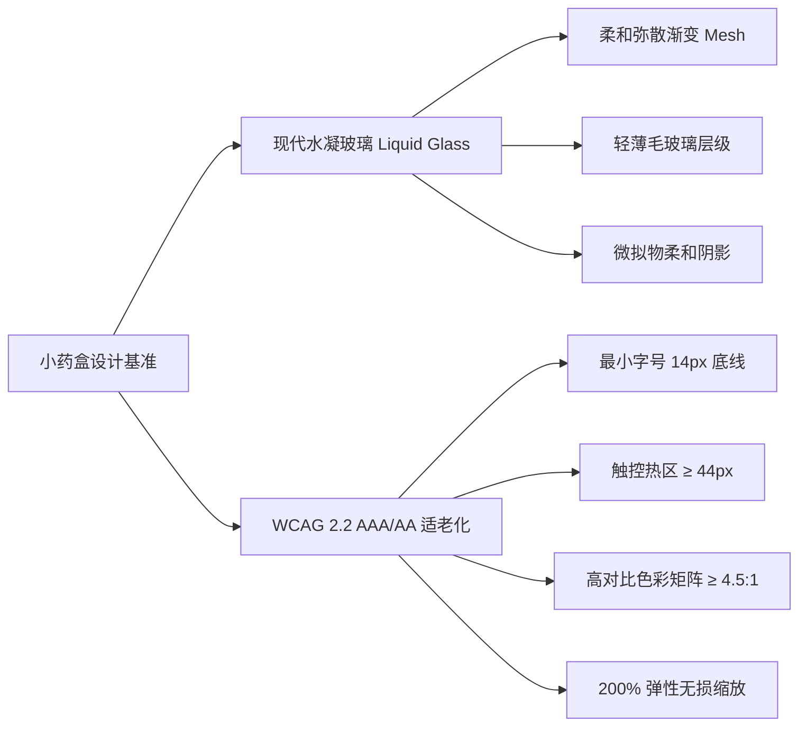
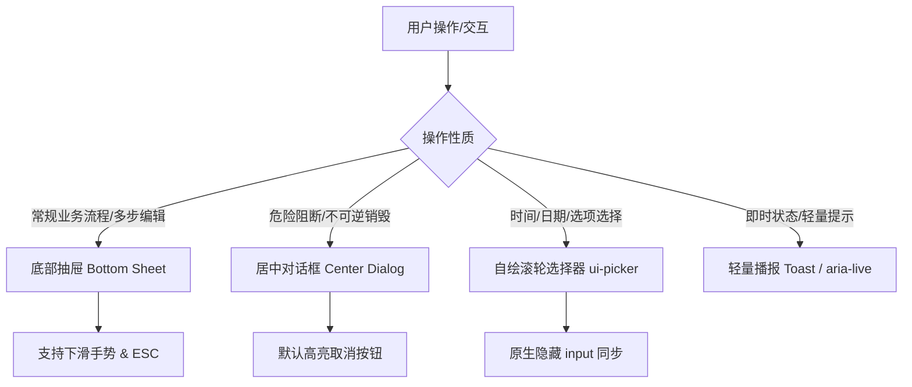
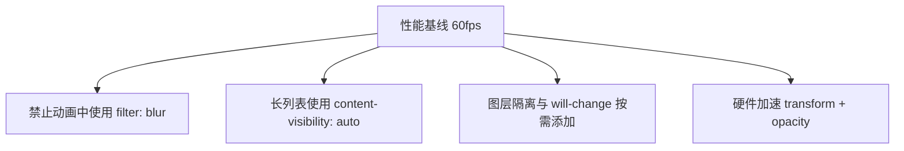

# 小药盒 (medbox) 系统级 UI/UX 设计规范

> **版本**：1.0.0  
> **更新时间**：2026-08-20  
> **适用工程**：`medbox/` (Android Capacitor + TypeScript PWA)  
> **定位**：跨多工具（Claude / GPT / Grok / Trae-Qoder / 人类工程师）的**唯一设计真理源（Single Source of Truth）**。任何 UI 修改、新增页面或重构必须严格遵守本规范。

---

## 目录

1. [设计哲学与用户画像 (Philosophy & Personas)](#1-设计哲学与用户画像)
2. [Design Tokens 与视觉基础 (Visual Foundation & Tokens)](#2-design-tokens-与视觉基础)
3. [适老化与无障碍标准 (Accessibility & Senior-Friendly)](#3-适老化与无障碍标准)
4. [组件层级与交互模式 (Component Hierarchy & Patterns)](#4-组件层级与交互模式)
5. [核心业务场景界面规范 (Core Business Screen Specs)](#5-核心业务场景界面规范)
6. [动效、渲染性能与多端适配 (Motion, Performance & Edge-to-Edge)](#6-动效渲染性能与多端适配)
7. [代码落地映射与开发契约 (Code Mapping & Engineering Contracts)](#7-代码落地映射与开发契约)

---

## 1. 设计哲学与用户画像

### 1.1 核心设计定位：双轨并重

小药盒（medbox）兼顾**年轻照护者/科技爱好者**对精致现代美感的追求，与**长辈/视力障碍者**对极端清晰易用的刚需。



### 1.2 核心设计铁律

1. **认知负荷极小化（Zero Cognitive Friction）**
   - 核心任务（如「确认服药」、「查看今天还有什么药没吃」）在 1 步以内直达。
   - 避免深层嵌套路由，常规编辑与向导统一使用半屏/底部抽屉（Bottom Sheet）。
2. **容错与误触防御（Defensive UI & Forgiveness）**
   - 危险操作（删除药品、重置数据）必须二次居中确认，且默认高亮安全选项（取消）。
   - 服药打卡支持误触一键撤销（Undo Toast，保留 5 秒）。
3. **确定性视觉反馈（Deterministic Feedback）**
   - 每次点击必须伴随即时的触摸反馈（`:active` 物理下沉 `scale(0.97)`、状态徽标即时刷新、带 `aria-live` 的屏幕播报）。
4. **全环境自洽（Environment Resilience）**
   - 强阳光下清晰可读，夜间暗色模式不刺眼。
   - 离线可用，局域网一键同步，无网络依赖焦虑。

---

## 2. Design Tokens 与视觉基础

所有颜色、字阶、间距、圆角与阴影必须通过 CSS 变量（`tokens.css`）引用，**严禁在页面或组件中使用任何硬编码色值或绝对像素**。

### 2.1 色彩体系与语义

#### 品牌主色 (Brand & Accents)
- **Primary / 品牌主色**：
  - 浅色：`--color-primary: #5c62d6` (Deep Indigo) | 渐变：`--color-primary-gradient: linear-gradient(135deg, #6366f1 0%, #4f46e5 100%)`
  - 深色：`--color-primary: #8b90e8` (Soft Periwinkle) | 渐变：`linear-gradient(135deg, #7c82ee 0%, #6a5fe0 100%)`
- **Hero / 极光渐变**：
  - `--color-hero-gradient: linear-gradient(135deg, #818cf8 0%, #c084fc 50%, #38bdf8 100%)`
- **Soft / 强调浅底**：
  - 浅色：`--color-primary-soft: #eef0ff` | 深色：`--color-primary-soft: #2b2e49`

#### 状态色彩 (Status Tones)
状态色彩必须严格满足 WCAG 2.2 AA (对比度 ≥ 4.5:1)：

| 状态类型 | 语义含义 | 浅色 Token (`-fg` / `-bg` / `-border`) | 深色 Token (`-fg` / `-bg` / `-border`) |
|---|---|---|---|
| **Tone Ok** | 已服药 / 库存充足以 / 同步成功 | `#17603f` / `#e4f5ec` / `#b9e2cb` | `#74d6a2` / `rgba(52,199,89,0.18)` / `rgba(52,199,89,0.40)` |
| **Tone Warn** | 即将服药 / 库存偏低 / 离线提醒 | `#8a4c0d` / `#fdefdf` / `#ecc794` | `#fbbf24` / `rgba(255,149,0,0.20)` / `rgba(255,149,0,0.40)` |
| **Tone Danger** | 漏服 / 药品过期 / 严重错误 | `#a32f38` / `#fdebec` / `#f0bcc0` | `#f87171` / `rgba(255,59,48,0.18)` / `rgba(255,59,48,0.40)` |
| **Tone Info** | 提示信息 / 建议 / 统计说明 | `#4348a8` / `#eaeafb` / `#c9caf1` | `#9aa8f5` / `rgba(122,108,244,0.20)` / `rgba(122,108,244,0.42)` |
| **Tone Muted** | 次要辅助 / 占位 / 未开启 | `var(--color-text-muted)` / `var(--color-surface-muted)` / `var(--color-border)` | 同左 |

#### 时段色彩 (Time Slot Accents)
时段色与用药状态色彩隔离，专用于一天内不同服药时间槽位：
- 🌅 **Morning (早)**：`--tint-orange-fg` (`#a3671f` / `#eab676`) | 背景：`--tint-orange-bg`
- ☀️ **Noon (午)**：`--tint-blue-fg` (`#35a2a9` / `#7fd0d5`) | 背景：`--tint-blue-bg`
- 🌇 **Evening (晚)**：`--tint-purple-fg` (`#666dd2` / `#a3a8f0`) | 背景：`--tint-purple-bg`
- 🌙 **Bedtime (睡前)**：`--tint-pink-fg` (`#d05a68` / `#f0a3ac`) | 背景：`--tint-pink-bg`

### 2.2 材质与暗色系统 (Liquid Glass & Dark Mode)

```css
/* 浅色基底 */
:root {
  --color-bg-mesh: radial-gradient(at 10% 10%, #e0e7ff 0px, transparent 50%),
                    radial-gradient(at 90% 20%, #fae8ff 0px, transparent 50%),
                    radial-gradient(at 50% 80%, #e0f2fe 0px, transparent 50%),
                    #f1f3f9;
  --color-surface: rgba(255, 255, 255, 0.88);
  --color-surface-glass: rgba(255, 255, 255, 0.78);
  --color-surface-solid: #ffffff;
  --color-border-glass: rgba(255, 255, 255, 0.88);
  --glass-blur: 16px;
  --scrim: rgb(28 30 38 / 36%);
}

/* 深色模式：系统与应用设置统一在 <html data-theme="dark"> 上触发 */
:root[data-theme='dark'] {
  --color-bg-mesh: radial-gradient(at 10% 10%, #262a3d 0px, transparent 50%),
                    radial-gradient(at 90% 20%, #33233d 0px, transparent 50%),
                    radial-gradient(at 50% 80%, #1c2a3d 0px, transparent 50%),
                    #14151a;
  --color-surface: rgba(32, 33, 40, 0.88);
  --color-surface-glass: rgba(32, 33, 40, 0.78);
  --color-surface-solid: #202128;
  --color-border-glass: rgba(255, 255, 255, 0.16);
  --scrim: rgba(0, 0, 0, 0.56);
}
```

### 2.3 排版字阶 (Typography Scale)

基准字体族：`--font-sans: 'MiSans', 'HarmonyOS Sans SC', 'PingFang SC', 'Microsoft YaHei', sans-serif`。

| Token | 字号 (px) | 字重 (Weight) | 行高 | 典型应用场景 |
|---|---|---|---|---|
| `--fs-largeTitle` | 32px | 700 / 800 | 1.2 | 大卡片主统计数字、全屏倒计时 |
| `--fs-title1` | 28px | 700 | 1.25 | 一级页面大标题、今日打卡进度 |
| `--fs-title2` | 22px | 600 | 1.3 | 二级顶栏标题、弹窗/抽屉主标题 |
| `--fs-title3` | 18px | 600 | 1.35 | 药品卡片主药名、时段组标题 |
| `--fs-body` | **16px** (基准) | 400 / 500 / 600 | 1.5 | 正文字段、按钮文字、输入框输入文本 |
| `--fs-subheadline`| 14px | 500 | 1.45 | 次要标签、规格剂量说明 |
| `--fs-footnote` | 14px | 400 | 1.4 | 提示文字、错误信息、表单 Helper |
| `--fs-caption` | **14px** (底线) | 500 / 600 | 1.3 | 胶囊徽标、角标文字（**严禁 < 12px**） |

### 2.4 间距、圆角与热区 (Spacing, Radii & Tap Targets)

- **触控热区基准**：`--tap: 44px`（所有可点击元素的点击盒模型严格不得小于 44×44 CSS px）。
- **间距递进 (Spacing Token)**：
  - `--space-1: 4px` (微距、图标与文字内嵌微调)
  - `--space-2: 8px` (紧凑元素间距、输入框内边距)
  - `--space-3: 12px` (标准组件内边距、小卡片内边距)
  - `--space-4: 16px` (页面左右安全边距、标准卡片内边距)
  - `--space-5: 20px` (抽屉/弹窗内边距、卡片间距)
  - `--space-6: 24px` (区块间距)
  - `--space-7: 32px` (大模块留白)
  - `--space-8: 40px` (页面底部留白)
- **圆角层级 (Border Radii)**：
  - `--radius-sm: 10px` (输入框、选项卡片)
  - `--radius-md: 14px` (按钮、普通卡片、折叠面板)
  - `--radius-lg: 20px` (主操作大按钮、弹窗主体)
  - `--radius-xl: 26px` (高透玻璃卡片、今日进度卡片、底部抽屉顶角)
  - `--radius-full: 999px` (胶囊 Pill、徽标 Badge、圆形图标)

---

## 3. 适老化与无障碍标准

遵循 **WCAG 2.2 Level AA / 核心条目 AAA** 规范。

### 3.1 视口缩放与大字适配 (WCAG 1.4.4)
- **绝对禁止锁死缩放**：`index.html` 的 `viewport` 必须为 `<meta name="viewport" content="width=device-width, initial-scale=1.0, viewport-fit=cover">`，严禁包含 `user-scalable=no` 或 `maximum-scale=1.0`。
- **200% 缩放自适应**：
  - 所有卡片内部文字容器禁止使用固定 `height` 或 `overflow: hidden` 强制单行省略。
  - 使用 `flex-wrap: wrap` 与 `min-inline-size: 0` 保证在系统字体放大至 200% 时，药品名称、剂量单位和打卡按钮自动向下折行，不破坏布局。

### 3.2 触控目标与无障碍热区 (WCAG 2.5.5)
- 所有独立交互元素（按钮、开关、Tab 选项、列表展开 Chevron、Chip 胶囊）必须满足 `min-block-size: var(--tap)` (44px)。
- 视觉紧凑的次级小图标（如 24px 的删除图标），必须通过伪元素或透明内边距扩展至 44px 的有效命中区域：
  ```css
  .icon-btn-compact {
    inline-size: 24px;
    block-size: 24px;
    padding: 10px; /* 实际触控区 44x44px */
  }
  ```

### 3.3 语义化结构与屏幕阅读器支持 (ARIA & Focus)
1. **模态弹窗与抽屉**：
   - 根容器必须声明 `role="dialog"` 与 `aria-modal="true"`，并用 `aria-labelledby` 关联标题 ID。
   - 打开时自动聚焦于首个输入框或主操作按钮；Tab 键在弹窗内形成**焦点陷阱（Focus Trap）**；按 `Escape` 键关闭并立即将焦点归还触发元素。
2. **异步状态播报 (Toast & Status)**：
   - Toast 容器必须包含 `role="status"`、`aria-live="polite"`、`aria-atomic="true"`。
3. **切换状态同步**：
   - 可切换胶囊（Chip / Segmented Button）必须通过 `aria-pressed="true|false"` 显式声明状态。
4. **导航地标**：
   - 底部主导航必须标记 `<nav class="tabbar" aria-label="主导航">`，当前选中项标记 `aria-current="page"`。

---

## 4. 组件层级与交互模式



### 4.1 按钮层级系统 (Button Hierarchy)

| 按钮类型 | CSS 类名 | 视觉表现 | 使用场景 |
|---|---|---|---|
| **主按钮 (Primary)** | `.btn` 或 `.ui-button-primary` | 渐变背景 + 柔和投影 + 白字 | 核心确认、确认服药、保存、创建 |
| **次级按钮 (Tonal)** | `.btn.tonal` 或 `.ui-button-secondary` | 浅紫背景 (`--color-primary-soft`) + 主色字 | 辅助操作、添加药品、查看明细 |
| **描边按钮 (Outlined)** | `.btn.outlined` | 白色半透底 + 1px 主色边框 | 备选操作、更换照片、重试 |
| **危险按钮 (Danger)** | `.ui-button-danger` | 红色背景 (`--color-danger`) + 白字 | 删除药品、清空记录、解绑同步 |
| **文本按钮 (Text)** | `.btn.text` 或 `.ui-button-text` | 无边框背景 + 主色文字 | 取消、跳过、返回上一步 |
| **顶栏胶囊 (Topbar Pill)**| `.topbar-pill` | 药丸形态 + 图标 + 文字 (36px高/44px热区) | 顶栏快捷操作（如「+ 添加」、「同步」） |

- **触摸动效**：`.btn:active:not([disabled]) { transform: scale(0.97); }`。
- **异步加载态**：使用 `withBusyState(btn, asyncFn)` 统一包裹，按钮自动进入 `disabled` 状态并渲染 `spinner()`，严禁手写不一致的加载文字。

### 4.2 模态分层机制 (Modal System)

1. **底部抽屉 (Bottom Sheet)**：
   - 覆盖层：`.bottom-sheet-overlay` (`z-index: 240`，`backdrop-filter: blur(12px)`)。
   - 抽屉容器：`.bottom-sheet` (`max-block-size: min(80dvh, 720px)`，上圆角 `--radius-xl`)。
   - 用途：用药录入、药品批量编辑、服药打卡修正、AI 识别结果确认。
2. **居中对话框 (Center Dialog)**：
   - 覆盖层：`z-index: 300`。
   - 约束：卡片宽度 `min(90vw, 420px)`，标题字阶 `--fs-title2`，主文案 `--fs-body`，底部操作按钮采用双列网格（取消在左，确认在右）。
   - 用途：删除确认、重置警告、权限缺失说明。

### 4.3 表单与输入校验 (Forms & Validation)

- **统一字段结构**：所有输入项必须通过 `components.ts` 的 `field(label, input, options)` 工厂函数构造：
  ```html
  <div class="ui-form-field">
    <label for="med-name">药品名称 <span class="required">*</span></label>
    <input id="med-name" type="text" autocomplete="off" />
    <span class="ui-form-field-hint">请输入药品通用名或商品名</span>
  </div>
  ```
- **错误态反馈**：
  - 触发错误时，容器添加 `.ui-form-field.error` 类，输入框自动获得红边框 (`--color-danger`)，并渲染 `<span class="ui-form-field-error" role="alert">错误原因</span>`。
  - 输入框自动添加 `aria-invalid="true"` 与 `aria-describedby` 关联错误节点。

### 4.4 自绘时间与选项选择器 (`ui-picker`)

- 为规避 Android WebView 系统选择器在不同机型上的割裂与弹窗遮挡问题，一律采用自绘的 `ui-picker` 组件：
  - **滚轮选择器**：双列/三列滑动滚轮（时、分、时段），支持 `scroll-snap-type: y proximity` 与触控惯性滚动。
  - **选项列表**：单列卡片网格，选中项高亮背景 `--color-primary-soft`。
  - **底层同步**：隐藏一个 `1x1px` 原生 `input[type="time|date"]`，确保表单与无障碍无缝兼容。

---

## 5. 核心业务场景界面规范

### 5.1 今日服药场景 (Today Dashboard)

```
+-----------------------------------------------------------+
| [小药盒 Logo]  今天 (8月20日 星期四)         [+ 快速录入]  |
+-----------------------------------------------------------+
| +-------------------------------------------------------+ |
| |  [ 环形进度 75% ]  今日已服 3 / 4 次用药计划          | |
| |                    下次服药：晚间 (18:30) 降压药      | |
| +-------------------------------------------------------+ |
|                                                           |
| 🌅 早间服药 (08:00)                         [ 全部已服 ✅ ]|
| +-------------------------------------------------------+ |
| | 💊 氨氯地平片 (5mg)   1片 / 饭后服          [ 已服 08:15 ]|
| | 💊 复合维生素B        2片 / 随餐服          [ 已服 08:15 ]|
| +-------------------------------------------------------+ |
|                                                           |
| 🌇 晚间服药 (18:30)                         [ 待服药 ⏰ ] |
| +-------------------------------------------------------+ |
| | 💊 阿托伐他汀钙片     10mg / 睡前嚼服       [ 马上吃药 🔘]|
| +-------------------------------------------------------+ |
+-----------------------------------------------------------+
```

1. **进度环英雄卡片 (Progress Ring Hero Card)**：
   - 居中或左侧大尺寸 SVG 环形进度条（`stroke-dasharray` 动态计算），底色 `--color-primary-soft`，进度条采用 `--color-hero-gradient`。
   - 醒目大数字展现今日服药率（`--fs-largeTitle`），右侧配大号时钟与下次服药预告。
2. **分时段服药卡片 (Slotted Medication Cards)**：
   - 按早 (`morning`)、午 (`noon`)、晚 (`evening`)、睡前 (`bedtime`) 四组卡片展示。
   - 每组顶部包含时段图标 (`tint-icon`)、时段名称及一键全组打卡主按钮。
   - 单药条目支持右划或点击打卡，打卡成功后药名变为删除线弱化色 (`--color-text-muted`)，打卡按钮变为绿色状态徽章 (`.status-badge-success`)。

### 5.2 药品管理与库存批次 (Medication & Inventory)

1. **药箱列表 (Inventory Grid)**：
   - 卡片展现：药品高清裁剪盒照（圆角 `--radius-md`，长宽比 1:1）、药名、余量（如「剩余 14 粒 (约可服 7 天)」）、保质期。
   - **余量智能预警**：
     - `剩余天数 <= 3 天`：展示红色预警徽标 (`.status-badge-danger: 缺药预警`)。
     - `过期时间 < 30 天`：展示黄色临期徽标 (`.status-badge-warning: 即将过期`)。
2. **四角盒照裁剪 (Box Photo 4-Corner Crop)**：
   - 取景器覆盖半透明蒙层 (`--scrim`)，四角提供 44×44px 的可拖拽水滴锚点。
   - 底部操作栏提供「顺时针旋转 90°」、「自动透视矫正」、「重拍」与「完成裁剪」四项清晰按钮。

### 5.3 AI 小助手与多模态交互 (AI Assistant)

> 2026-09 重设计：「盒宝伙伴 × 水凝玻璃」（B+C 融合方向），高保真原型见 `design/assistant-redesign/`。

1. **助手面板挂载**：
   - 入口为各页面顶栏「✦ AI 助手」胶囊（`.topbar-pill`），与全站顶栏控件同一语言。
   - 展开后为**整板悬浮水凝玻璃**：四周留边 10px、`border-radius: 32px`、半透明磨砂（`blur(24px) saturate(150%)`）透出下层页面，顶部高光描边 + 柔和投影；`max-block-size: 86dvh`。
   - 展开为全屏时回归**实色背景**（`--color-bg`），摘掉模糊与透明，保证长文可读性与渲染性能。
2. **盒宝人格化（助手 = 盒宝）**：
   - 头部为盒宝圆形立像（`avatar_17_hebao.png`）+ 右下角在线小绿点，标题「盒宝 · 用药小助手」；低频动作（模型与推理偏好、清空记录）收进「更多」底部弹层，头部只保留 更多 / 展开 / 收起三枚玻璃圆钮。
   - 首次打开展示 hero 渐变欢迎卡（`--color-hero-gradient`）+ 探身盒宝（沿用空状态呼吸浮动），按时段切换问候（早上好/中午好/下午好/晚上好/夜深了）。
   - 每条助手消息左侧带 28px 盒宝小头像，卡片与头像列对齐，一眼分清「谁在说」。
3. **气泡与卡片材质**：
   - 助手气泡/结构化卡片：白磨砂玻璃（半透明实色 + 高光内描边）；用户气泡：主色渐变玻璃（`--color-primary-gradient`）。同族异色，层次分明。
   - 输入区为悬浮玻璃胶囊（脱离面板底边），是面板上唯一的「硬」元素；快捷问题为玻璃胶囊 + 主色小图标，单行横向滑动。
4. **性能铁律**：同屏 `backdrop-filter` 严格 ≤ 2 层（面板 + 输入条）；气泡/卡片/胶囊一律只用半透明实色，模糊由面板统一承担；`prefers-reduced-transparency: reduce` 时玻璃退化为近实色；环境光晕（对话区顶部两团静态青绿光）不做动画。
5. **Markdown 与结构化输出**：
   - 助手回复的药品剂量表、用药注意事项必须渲染为带高对比边框的表格（`--color-table-border`）或清晰列表。
   - **代码块/结构化数据**：固定深色背景 (`--color-code-bg: #2a2c36`)，高亮字色满足 7:1 超高对比度。
6. **极光动效（Aurora Effect）功耗控制**：
   - `.nlu-box::before` 的极光渐变动画仅在面板处于可视状态（`IntersectionObserver` 监测）时运行，面板关闭或后台时立即暂停以降低 GPU 功耗。

### 5.4 局域网家庭同步 (LAN Family Sync)

1. **一扫即连极简流向**：
   - 主设备展示高清动态二维码（高纠错级别，中间内嵌小药盒图标）。
   - 从设备点击「扫一扫连接」，取景框标注扫码引导线与辅助手电筒开关。
2. **连接状态可视化**：
   - 顶栏常驻展示局域网同步状态点（🟢 局域网已连接 / 🟡 同步中 / ⚪ 离线单机模式），点击直达同步管理面板。

---

## 6. 动效、渲染性能与多端适配

### 6.1 渲染性能铁律 (Performance Baseline)



1. **严禁在动画关键帧（Keyframes）中使用 `filter: blur()`**：
   - 页面入场、抽屉滑出必须仅使用 `transform: translate3d()` 与 `opacity`，防止在中端安卓机上引发 GPU 重绘风暴与严重掉帧。
2. **长列表渲染优化 (Content Visibility)**：
   - 药品列表项与服药历史记录必须声明：
     ```css
     .med-card, .history-row {
       content-visibility: auto;
       contain-intrinsic-size: 0 88px;
     }
     ```
3. **毛玻璃层级约束**：
   - 同一视口内叠加的 `backdrop-filter` 元素严禁超过 **2 层**。
   - 在开启 `prefers-reduced-transparency: reduce` 或检测到低性能设备时，自动将 `--color-surface` 降级为 98% 不透明实体背景并移除 `backdrop-filter`。

### 6.2 动效时间与曲线 (Motion Design Tokens)

- **标准转场时间**：
  - 微交互（按钮按下、开关切换、图标旋转）：`180ms` (`cubic-bezier(0.4, 0, 0.2, 1)`)
  - 中度交互（抽屉展开、折叠面板伸缩）：`260ms` (`cubic-bezier(0.32, 0.72, 0, 1)`)
  - 页面/模态转场：`320ms` (`cubic-bezier(0.16, 1, 0.3, 1)`)
- **系统减弱动效响应**：
  ```css
  @media (prefers-reduced-motion: reduce) {
    *, *::before, *::after {
      animation-duration: 0.01ms !important;
      transition-duration: 0.01ms !important;
      scroll-behavior: auto !important;
    }
  }
  ```

### 6.3 Android 15/16 Edge-to-Edge 与 Safe Area 适配

在 Android 15/16 强制全屏（Edge-to-Edge）特性下，系统状态栏与底部手势导航条高度直接注入 Webview。

- **Safe Area 变量绑定**：
  ```css
  --safe-top: max(env(safe-area-inset-top, 0px), var(--safe-area-inset-top, 0px));
  --safe-bottom: max(env(safe-area-inset-bottom, 0px), var(--safe-area-inset-bottom, 0px));
  --safe-left: max(env(safe-area-inset-left, 0px), var(--safe-area-inset-left, 0px));
  --safe-right: max(env(safe-area-inset-right, 0px), var(--safe-area-inset-right, 0px));
  ```
- **核心容器约束**：
  - 顶栏 `.topbar`：`padding-block-start: var(--safe-top); min-block-size: calc(56px + var(--safe-top));`
  - 底栏 `.tabbar`：`padding-block-end: var(--safe-bottom); min-block-size: calc(60px + var(--safe-bottom));`
  - 弹窗与抽屉 `.bottom-sheet-overlay`：必须将 `padding` 绑定全部四向 `--safe-*` 变量，严防内容被摄像头挖孔或手势小白条遮挡。

### 6.4 响应式断点矩阵 (Responsive Breakpoints)

| 设备类型 | 视口宽度范围 | 布局策略 |
|---|---|---|
| **超窄屏 / 折叠屏外屏** | `320px ~ 359px` | 顶栏按钮自动折叠为图标，进度环缩小至 88px，卡片内边距收缩至 `--space-3` (12px) |
| **标准主流手机** | `360px ~ 430px` | 标准单列流动布局，两列快捷操作，全尺寸 110px 进度环 |
| **大屏手机 / 折叠内屏** | `431px ~ 767px` | 药箱列表切换为双列网格 (`grid-template-columns: 1fr 1fr`) |
| **平板横屏 (Tablet)** | `≥ 768px` | 左侧固定导航栏（代替底部 Tabbar），今日服药与服药历史采用双栏并列视图 |

---

## 7. 代码落地映射与开发契约

### 7.1 文件组织与职责分工

```
medbox/
├── design/
│   └── design.md              <-- 本规范（唯一真理源）
└── src/ui/
    ├── styles/
    │   ├── tokens.css         <-- CSS 变量（色彩、字阶、间距、暗色覆盖）
    │   ├── primitives.css     <-- 基础原子类（.card, .btn, .chip, .ui-*）
    │   ├── shell.css          <-- 框架容器（.app-shell, .topbar, .tabbar）
    │   └── pages/             <-- 页面专属细节样式
    ├── components.ts          <-- DOM 工厂 (el, field, icon, toast, dialog)
    └── icons/                 <-- 本地锁版本的 Lucide SVG 图标库
```

### 7.2 核心 DOM 工厂调用契约

所有页面开发必须优先使用 `src/ui/components.ts` 暴露的标准工厂函数：

```typescript
// 1. 构造标准带无障碍语义的元素
const card = el('div', { class: 'card', 'aria-label': '降压药卡片' }, [
  el('h2', { text: '氨氯地平片 (5mg)' }),
  el('p', { class: 'muted', text: '每日 1 次，每次 1 片' }),
]);

// 2. 构造标准表单项（自动集成 Label、Hint、Error 和 ARIA 关联）
const nameField = field('药品通用名', el('input', { id: 'med-name', placeholder: '如：阿莫西林' }), {
  hint: '可参考药盒正面大字',
  required: true,
});

// 3. 构造异步操作按钮（自动处理 loading 与禁用状态）
const saveBtn = el('button', { class: 'btn', text: '保存药品' });
saveBtn.onclick = () => withBusyState(saveBtn, async () => {
  await saveMedicationData();
  toast('药品保存成功！');
});

// 4. 唤起全无障碍底部抽屉
openBottomSheet({
  title: '添加新药品',
  content: formContainer,
  onClose: () => console.log('抽屉已关闭'),
});
```

### 7.3 多工具协作维护规范

1. **修改流程**：
   - 若需调整全局视觉或新增组件规范，**必须先更新 `medbox/design/design.md`**，经团队评审或确认后，再同步修改 `tokens.css` / `components.ts`。
2. **禁止逆向篡改**：
   - 严禁在页面 CSS 中通过 `!important` 覆盖全局 Token；所有特殊定制必须通过局部 `--component-*` 作用域变量或扩展新 Token 完成。
3. **交付验收门禁**：
   - 每次 UI 改动提交前，必须运行并通过：
     ```powershell
     npm run typecheck
     npm run test
     npm run build:web
     ```
   - 在 Playwright 四视口测试（320px、390px、平板横屏、桌面）下无溢出与布局撕裂。
