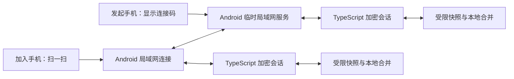

# Medbox 0.7.7 设计：Android App 局域网家庭同步

状态：Accepted  
日期：2026-07-17  
取代：`2026-07-17-medbox-0.7.6-inventory-crop-sync.md` 中的 PWA/Worker 家庭同步方向

## 1. 已确认目标

- 产品后续只按 Android App 交付，不再把 PWA 安装、Service Worker、Pages 部署或 Web 压缩包当成发布目标。
- 两台手机连接同一个 Wi-Fi 后，家庭用药资料直接在局域网内传送。
- 发起手机显示连接码，另一台手机只扫一次即可连接并同步。
- 设置页只使用普通用户能看懂的中文，不出现 Worker、Origin、WebRTC、端点、协议、密文等术语。
- 同步是手动、短时、前台操作；本版不承诺后台自动同步和跨网络同步。

## 2. 数据边界

允许传送：

1. 药品资料，但不含药盒照片、照片识别痕迹和本机库存数字。
2. 当前提醒规则。
3. 不可变的用药计划历史。
4. 已服或跳过的服药记录。

永不传送：

- 工时、收入、结算和工作资料。
- AI 地址、模型、授权记录和任何密钥。
- 药盒照片、处方照片、语音或其他附件。
- 系统通知权限、已排定通知和推送运行状态。
- 本地备份文件及其他工具的数据。

库存余量首版留在各自手机。两台手机都从“剩 10 粒”各记录一次服药时，直接覆盖库存数字会错误地得到 9 而不是 8；在引入可合并的补货/服用/撤销流水前，不同步 `Medication.inventory`。

TypeScript 在发送前只挑选允许字段，并在接收后用严格 schema 再验证一次。原生插件只收发不透明字符串，不理解也不保存健康数据。

## 3. 方案比较

### 采用：Android 原生临时 TCP 服务 + 一次扫码

- 发起手机临时监听局域网端口。
- 二维码包含局域网地址、端口、会话编号、两分钟有效期和一次性随机秘密。
- 加入手机扫码后直接连接；双方交换加密快照并合并。
- 完成、超时、切出页面或出错后立即关闭监听和连接。

优点：真正一次扫码；数据路径清楚；不依赖互联网或外部信令；故障提示容易转成普通话。  
代价：需要维护少量 Android 原生代码；访客 Wi-Fi 或公司网络可能隔离设备；两台 App 同步时都需留在前台。

### 不采用：无服务器 WebRTC

完全离线时必须交换 offer 和 answer，通常需要双方各扫一次；若强行一次扫码，仍需额外监听服务或外部信令。ICE、SDP、mDNS 和 WebView 差异会增加故障点，却不能解决 Wi-Fi 隔离。

### 不采用：云端 Worker 中转

不符合“本地局域网传送”，还继续带来部署、域名、账号和长期服务维护。0.7.7 将关闭现有云同步入口和自动启动路径。

## 4. 高层结构

组件边界：

- `android/.../lansync/`：选本机局域网地址、监听、连接、长度分帧、超时、断开。
- `src/sync/lan/nativeTransport.ts`：Capacitor 插件类型和事件封装。
- `src/sync/lan/invitation.ts`：生成、解析并校验两分钟单次邀请。
- `src/sync/lan/crypto.ts`：HKDF 派生会话密钥；AES-GCM 帧加密和重放检查。
- `src/sync/lan/entities.ts`：四类允许实体的 schema、字段选择和总量限制。
- `src/sync/lan/store.ts`：快照、版本元数据、确定性合并和单事务写入。
- `src/sync/lan/session.ts`：发起/加入状态机与 UI 可读结果。
- `src/pages/Settings.ts`：只负责编排显示连接码、扫码、进度和结果。

## 5. 会话流程

1. 发起端注册原生事件监听，再启动临时服务。
2. App 生成 256 位随机秘密和会话编号，二维码有效期两分钟。
3. 加入端扫码，严格校验格式、地址、端口和有效期后连接。
4. 加入端发送加密的设备信息与本地快照。
5. 发起端校验、合并并在一个 IndexedDB 事务内应用结果，再返回合并快照。
6. 加入端校验并应用相同结果，返回完成确认。
7. 发起端收到确认后，两端显示“已同步”并关闭连接。

任何一步失败都不做半包解析；数据库写入必须整批成功或整批回滚。网络中断后用户可重新生成连接码再试，重复同步不会重复制造记录。

## 6. 加密和限制

- 二维码秘密只活在当前会话，不作为长期家庭密钥保存。
- 使用 Web Crypto HKDF-SHA-256 从一次性秘密派生 AES-GCM-256 会话密钥。
- 每个消息使用随机 96 位 IV；会话编号、发送方向、消息类型和递增序号作为 AAD。
- 收到重复或倒退的序号立即终止，避免重放。
- 邀请两分钟失效且原生服务只接受一个连接；成功连接后立即停止继续监听。
- 原生帧上限 8 MiB；解密后的 JSON 上限 5 MiB；最多 10,000 条实体；单字段和数组继续受 Zod schema 限制。
- 只接受私有/链路本地 IP，不接受域名、公网 IP、凭据或额外路径。
- 错误日志只写状态码，不写二维码、秘密、药名或快照正文。

## 7. 合并规则

IndexedDB 升级到 v6，新增 `syncLanMetadata`。每条实体保存：操作类型、逻辑计数器、产生版本的设备编号和内容摘要。设备编号与本地计数器只保存在本机。

- 本地内容相对上次摘要变化时，逻辑计数器加一。
- 合并先比较计数器；相同再比较设备编号，保证两端选出同一结果。
- 删除也是一个版本并保留墓碑，旧手机不能把已删药品带回来。
- 相同版本和相同摘要是重复传输；相同版本但摘要不同视为损坏并中止。
- 计划历史不可变，同 ID 不重复覆盖。
- 同时修改同一药品、提醒或服药记录时按确定规则收敛；库存发生冲突时在结果里提示“请核对库存”。
- 应用完成后重新安排本机提醒，但绝不传送另一台手机的系统通知状态。

## 8. 设置页文案与状态

面板标题：`局域网家庭同步`  
面板说明：`两台手机连着同一个 Wi-Fi 时，可以直接互相传。药品、提醒和服药记录不会经过网上的服务器。`

补充说明：`两台手机的库存数字各自保留，避免同时记录时算错。`

主要按钮：

- `显示连接码`
- `扫一扫连接`

过程文案：

- `请让另一台手机扫这个码`
- `正在连接`
- `正在传送`
- `已同步`

失败文案：

- `没有连上。请确认两台手机用了同一个 Wi-Fi，再试一次。`
- `这个连接码已经过期，请重新生成。`
- `当前 Wi-Fi 不允许手机互相连接，可以换一个网络后重试。`
- `相机打不开，也可以从相册选择连接码。`

连接码弹层提供关闭按钮和剩余时间；扫码弹层支持相机与相册。所有退出路径都必须停止相机并关闭原生连接。

## 9. 非功能要求

- 无互联网但同一 Wi-Fi 时可完成同步。
- 典型家庭数据在连接成功后 10 秒内完成；连接尝试 10 秒超时，空闲 30 秒超时。
- 交换顺序无关、重复执行不变；任一端中途断开不能留下半次数据库写入。
- Android API 24 至 36 可构建；API 35/36 至少完成一组双机或模拟器到真机验证记录。
- 网络隔离、VPN、多网卡、IPv4/IPv6 和手机热点是重点测试项；本版不承诺每种受管网络都可用。
- 原生代码保持薄层，无后台常驻、无发现服务、无云依赖。

## 10. 失败模式

| 情况 | 行为 |
|---|---|
| 连接码过期或重复使用 | 拒绝并要求重新显示连接码 |
| 两台手机不在同一 Wi-Fi | 10 秒内结束并显示同网提示 |
| Wi-Fi 隔离或 VPN 干扰 | 结束连接，不持续转圈，提示换网络 |
| App 切后台或离开设置页 | 关闭相机、监听与 Socket；未提交事务回滚 |
| 消息超大、schema 不符或解密失败 | 不写数据库，关闭会话，显示“资料没有传完，请重试” |
| 同步时本地又发生编辑 | 事务前摘要不一致则暂缓该项，下一次再同步 |
| 提醒重排失败 | 数据仍保留，提示重新打开 App 后再检查提醒 |

## 11. 实施与验收

1. 先写局域网邀请、加密、实体限制和合并的失败测试。
2. 增加 DB v6 与 TypeScript 会话层，再实现 Android 插件及帧编解码单测。
3. 用 `qrcode` 生成连接码，复用现有扫码器并限制为 QR。
4. 替换设置页云同步面板，移除顶部云同步状态和启动时云同步。
5. 移除 PWA 插件、Service Worker 注册、Pages/网页发布入口；保留 Vite WebView 资源构建和浏览器开发预览。
6. 版本升到 `0.7.7` / Android `versionCode 14`，发布只生成 APK 与校验文件。
7. 通过 TypeScript、Vitest、Playwright、Android unit/build、APK 内资源核对和 `git diff --check`。
8. 更新 `docs/handoffs/gpt.md`，在 `workspace/gpt` 提交；验证完成后再合入 `main` 并同步其他长期工具分支。

## 12. ADR-001：采用 Android 原生临时局域网服务

### Status

Accepted

### Context

产品改为 Android App，用户要求本地局域网传送和一次扫码。浏览器不能可靠监听局域网端口；无服务器 WebRTC 需要双向交换连接信息。

### Decision

使用 Capacitor 自定义 Android 插件承载短时 TCP 连接，TypeScript 负责加密、schema 和合并。App 不使用外部信令、TURN 或云端同步服务。

### Consequences

正面：一次扫码、无互联网可用、数据路径可审计、设置简单。  
负面：需要原生维护与双机测试；受 Wi-Fi 隔离影响；只支持 Android App。  
中性：Vite 仍用于生成 Capacitor 内嵌页面，但这些页面不再作为 PWA 产品发布。

### Alternatives Considered

- WebRTC DataChannel：离线一次扫码无法完整交换连接信息，额外复杂度没有带来目标收益。
- Worker/云端中转：违背局域网直传并增加外部运维。
- WebView 直接 HTTP：不能监听端口，并受混合内容和局域网访问策略影响。
